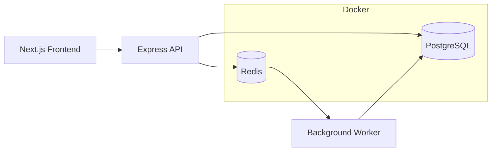

# CloudPilot

**AI-Powered Cloud and DevOps Automation Platform**

[](https://nextjs.org/)
[](https://www.typescriptlang.org/)
[](https://www.postgresql.org/)
[](https://www.prisma.io/)
[](https://redis.io/)
[](https://docs.bullmq.io/)
[](https://www.docker.com/)

CloudPilot is a monorepo platform for building secure, observable, and scalable DevOps
automation. Its foundation includes a Next.js control-plane frontend, Express API,
PostgreSQL data layer, Redis-backed job infrastructure, and a background worker.

## Objectives

- Centralize workspace, project, repository, deployment, build, and audit data
- Isolate tenant operations through workspace-scoped authorization and data models
- Provide reliable deployment and build job processing
- Preserve deployment idempotency and auditable lifecycle history
- Prepare the platform for future automation, monitoring, and AI-assisted analysis

## Technology Stack

| Area | Technology |
|---|---|
| Frontend | Next.js 16, React 19, TypeScript, Tailwind CSS 4 |
| UI | shadcn/ui, Radix UI, Lucide |
| Backend | Express 5, TypeScript, Zod, Pino |
| Database | PostgreSQL 15, Prisma 7 |
| Queue | BullMQ 6, ioredis 6, Redis 7 |
| Monorepo | npm workspaces |
| Infrastructure | Docker Compose |

## Architecture



## Monorepo

```text
apps/
  web/       Next.js frontend
  api/       Express API
  worker/    BullMQ worker
packages/
  database/  Shared Prisma package
  queue/     Shared queue contracts and Redis utilities
  shared/    Shared package
  config/    Shared configuration
docs/        Architecture and operational documentation
docker-compose.yml
```

## Implemented Features

- Next.js 16 frontend foundation
- Express API with Helmet, CORS, Pino, rate limiting, request IDs, and centralized errors
- PostgreSQL 15 Docker infrastructure on loopback port `5433`
- Prisma shared database workspace and applied migrations
- Workspace-oriented multi-tenant database foundation
- Environment-specific encrypted secret storage design
- Deployment idempotency and rollback relationship constraints
- Redis 7 infrastructure with AOF persistence on loopback port `6379`
- BullMQ queue workspace and background worker
- Typed deployment, build, rollback, and diagnostic contracts
- Cooperative execution cancellation and retry policy foundation
- API liveness and dependency readiness endpoints
- Docker health checks for PostgreSQL and Redis

## Planned Features

- Authentication and authorization
- Dashboard and operational UI
- Real deployment execution engine
- GitHub repository integration
- Redis/BullMQ transactional reconciliation
- PostgreSQL secret encryption and key rotation
- Prometheus and Grafana
- AWS infrastructure and Terraform
- Kubernetes and container orchestration
- AI log analysis
- Self-healing infrastructure

## Local Setup

Requirements:

- Node.js 22+
- npm 11+
- Docker Engine and Docker Compose

```powershell
npm install
Copy-Item .env.example .env
docker compose up -d postgres redis
npm run db:generate
npm run db:status
npm run build -w @cloudpilot/database
npm run build -w @cloudpilot/queue
npm run build -w @cloudpilot/worker
npm run build -w @cloudpilot/api
```

Update `.env` with local development credentials. Never commit the real `.env`.

## Database

```powershell
npm run db:format
npm run db:validate
npm run db:generate
npm run db:migrate
npm run db:status
npm run db:studio
```

PostgreSQL is published only on `127.0.0.1:5433`. Its data is retained in the
`cloudpilot_postgres_data` named volume.

## Queue Worker

```powershell
npm run worker:dev
npm run worker:build
npm run worker:start
npm run queue:diagnostic
```

Redis is published only on `127.0.0.1:6379` and retained in the
`cloudpilot_redis_data` named volume.

```powershell
docker compose ps
docker compose up -d postgres redis
docker compose restart redis
```

## API Endpoints

- `GET /health`
- `GET /api/v1/health`
- `GET /api/v1/health/live`
- `GET /api/v1/health/ready`

Readiness returns HTTP 200 when PostgreSQL and Redis are healthy and HTTP 503
when a currently required dependency is unavailable.

## Security and Known Limitations

- Keep local `.env` credentials out of source control.
- Queue payloads must not contain passwords, OAuth tokens, or plaintext secrets.
- BullMQ processing is at-least-once, not exactly-once.
- PostgreSQL deployment idempotency remains the database-level deduplication boundary.
- The existing Prisma Effect dependency advisory is documented in [docs/security.md](docs/security.md).
- Secret encryption and key rotation are designed but not yet operational.
- Worker graceful shutdown on Unix-style signals requires final container-platform verification.

## Author

**Razique Hasan**

- GitHub: https://github.com/raziquehasan
- Repository: https://github.com/raziquehasan/CloudPilot
